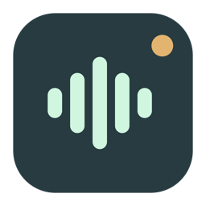

<p align="center">
  
</p>
<h1 align="center">Dunkerfy</h1>
<p align="center"><strong>A sound for every Mac app.</strong></p>
<p align="center">A native macOS utility for custom notification sounds, written in Rust.<br>Give your inbox, team mentions, and finished builds sounds you recognize.</p>
<p align="center">
  <a href="https://dunkerfy.oleary.club">Website</a> ·
  <a href="https://github.com/JaTochNietDan/dunkerfy/releases/tag/v0.2.2">Download preview</a> ·
  <a href="#setup">Setup</a> ·
  <a href="#build-from-source">Build</a> ·
  <a href="https://github.com/JaTochNietDan/dunkerfy/issues">Report an issue</a>
</p>

---

## What it does

Dunkerfy watches visible macOS Notification Center banners and plays a sound when one matches your rules. Start with a sound for an app, then optionally narrow it to a person, channel, or keyword in the notification text.

For example:

| When a notification comes from… | And its text contains… | Play… |
| --- | --- | --- |
| Mail | anything | a quiet chime |
| Your team chat app | your name | a brighter sound |
| Your development tools | “succeeded” | your own completion sound |

These are illustrative rules, not a list of verified app integrations. The source app must send visible macOS banners with accessible text.

## Features

- **Per-app sounds** with optional, case-insensitive keyword matching.
- **Ordered rules**: the first enabled matching rule wins.
- **Your own audio**: import AIFF, WAV, MP3, M4A, or CAF files up to 20 MB, or choose built-in macOS sounds.
- **Volume and cooldowns**: per-rule volume, a master volume, and protection from repeated sounds.
- **Native Mac interface**: AppKit windows, menus, controls, and file pickers. No webview or Electron.
- **Menu bar controls**: pause, resume, reopen the window, or quit. Optional launch at login.
- **Local activity log**: inspect matches and playback results. At most 60 entries, kept only in memory.
- **No account or cloud processing**: no analytics, no notification uploads, and notification bodies never written to disk.

## Download

**[Download v0.2.2 for Apple Silicon](https://github.com/JaTochNietDan/dunkerfy/releases/download/v0.2.2/Dunkerfy-0.2.2-macOS-arm64.zip)** · macOS 13 or later

> **Developer preview:** this is an early release. The app is **Developer ID signed and Apple-notarized**. Rule logic, storage, native UI construction, and simulated sound playback have been tested. **Live third-party notification capture has not yet been verified.** See [validation results](VALIDATION.md) for the exact scope.

The downloadable build is for Apple Silicon. Intel builds and compatibility across macOS versions have not been tested. You can also build the source locally.

## Setup

1. Unzip the download and move **Dunkerfy.app** to `/Applications` before granting permissions.
2. On startup, Dunkerfy requests Accessibility access if it is missing and opens its setup page. Follow the macOS prompt or use **Open Accessibility settings**. Enable Dunkerfy under **Privacy & Security → Accessibility**. Use the system panel’s **+** button if it is not listed.
3. In macOS **Notifications**, keep banners or alerts enabled for each source app and disable its original notification sound. Some apps have a separate in-app sound setting. **Dunkerfy plays additional audio; it cannot cancel an app’s original sound.**
4. Create a rule. Choose an application or enter the exact app name shown on its banner. Pick a sound, optionally enter a keyword, and save.
5. Trigger a real notification and check **Activity**. Put specific rules above general ones.

**Preview** plays a sound. **Test rule** simulates an event against the current editor contents. Neither verifies that macOS live capture is working, and both intentionally work while listening is paused.

Closing the window leaves the app in the menu bar. Choose **Quit Dunkerfy** to stop monitoring.

## How it works—and its limits

A background Rust worker uses macOS Accessibility APIs to inspect Notification Center’s visible banner and alert elements every 400 ms. The rule engine matches locally; AppKit plays the selected audio. Existing banners establish a silent baseline at launch, and visible element identities prevent repeated playback on every scan.

macOS does not expose a supported public API for subscribing to every other app’s notifications. Notification Center’s Accessibility structure can change, so this integration requires live verification on each supported macOS release.

- Focus, disabled banners, hidden previews, or very brief banners may prevent matching.
- App names are matched exactly, ignoring case. Localized or helper-app names may need to be entered manually.
- Most banners do not expose an authoritative source bundle ID, so matching falls back to the visible app name.
- If macOS reuses a visible Accessibility element for a distinct notification, that notification may be missed.
- One sound plays at a time; a new match replaces current playback.

[Read the technical details →](docs/DEVELOPMENT.md#how-notification-capture-works)

## Build from source

You need macOS, Apple Command Line Tools or Xcode, and [mise](https://mise.jdx.dev/). **No Homebrew or standalone rustup installation is needed.**

```sh
git clone https://github.com/JaTochNietDan/dunkerfy.git
cd dunkerfy
mise trust
mise install
mise run test
mise run check
mise run build
open dist/Dunkerfy.app
```

Mise pins Rust, rustfmt, clippy, Node, and Wrangler. Its Rust backend uses rustup internally, with state confined to the ignored `.mise/` directory. Node and Wrangler are for the website; the desktop application is Rust and AppKit. Library versions are locked in `Cargo.lock`.

```sh
mise exec -- cargo fmt --check
mise exec -- cargo run -- --smoke-test
```

The smoke test constructs the native UI without playing audio or saving rules. GitHub Actions is intentionally disabled; checks and releases are run locally.

## Privacy and storage

Rules and preferences live in `~/Library/Application Support/Dunkerfy/settings.json`. Imported audio is copied into the adjacent `Sounds/` directory.

Notification text is processed locally. Activity hides it by default, never writes it to disk, and clears retained text when you turn that option off. The application has no analytics. Optional update checks contact the Dunkerfy website and GitHub; these requests never include notification content, rules, or sounds.

## Project map

| Path | Purpose |
| --- | --- |
| `src/model.rs` | Settings, validation, matching, and cooldowns |
| `src/monitor.rs` | Accessibility reader, isolated on its own thread |
| `src/mac.rs` | Native UI, sound playback, and login items |
| `src/storage.rs` | Atomic persistence and imported sounds |
| `tests/` | Rule, parser, validation, and storage tests |
| `website/` | Static landing page deployed to Cloudflare Workers |
| `scripts/` | Local app build and website checks |

[Development notes](docs/DEVELOPMENT.md) · [Website deployment](docs/DEPLOYMENT.md) · [Validation](VALIDATION.md)

## Contributing

Issues and pull requests are welcome. For notification-capture issues, include your macOS version, source app, whether its banners are enabled, and what Activity reports. Please redact notification content before sharing logs or images.

Dunkerfy is an independent project inspired by the idea of per-app notification sounds. It is not affiliated with Chirpy and uses no Chirpy code or assets.

## License

[MIT](LICENSE) · Robert O’Leary and contributors.

## In-app updates

Sparkle is integrated directly from Rust, with an Updates page, Check for Updates menu item, opt-in automatic checks and installation, and signed feeds/downloads. Version 0.2.2 is Developer ID signed and notarized, with a signed production update feed. A full installation/relaunch test is still pending. Users of 0.1.0 must install manually; 0.2.0 includes Check for Updates.

See [update and signing setup](docs/UPDATES.md) for the mise-managed release workflow.

## Compact UI and sound bank

The native interface now uses a smaller 964 × 620 window, an icon sidebar, rounded panels, teal actions, and light/dark styling. The soundboard has search, category filters, previews with a Stop control, and a Use action to create a rule with your chosen sound.

Thirty sounds ship with the app: the CC0 **Wilhelm scream** plus 29 original effects. Fun presets include sad trombone, air horn, ba dum tss, record scratch, rubber boing, slide whistle, rubber duck, whoopee, tiny violin, crickets, and a dramatic sting. Arcade cues include coin, level up, power up, game over, pew pew, checkpoint, combo breaker, and pixel hop. Seven calmer tones round out the bank. Existing macOS and imported sounds remain available.

See [audio attribution](Resources/Sounds/ATTRIBUTION.md). The original effects can be regenerated with `mise run sounds-generate`. `mise run ui-preview` renders the actual AppKit views using sample rules for local layout review; it does not capture your screen or notification contents.
